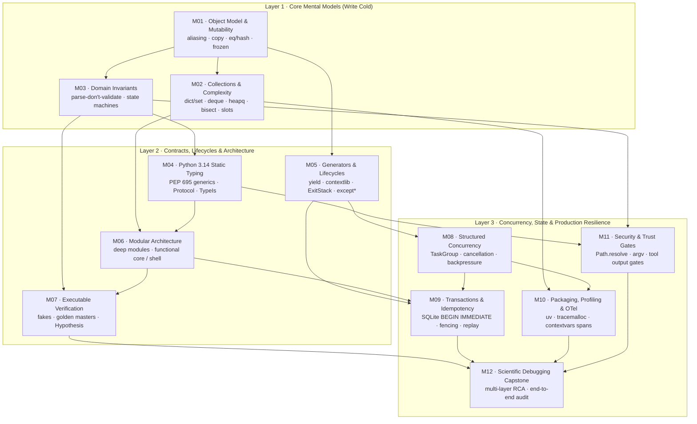

# Python 3.14 & Software Engineering Fundamentals in the AI Era

**Repository:** `https://github.com/xavierxmorris/python-se-fundamentals-lab` (`C:\Users\xaviermorris\Documents\python-se-fundamentals-lab`)  
**Cadence:** Twelve 60–90 minute modules (`M01`–`M12`, 12–18 hours total)  
**Toolchain:** CPython 3.14 · `uv` · `pytest` · `pyright --strict` · `ruff` · `hypothesis` (stdlib everywhere else)  
**Spine Domain:** `taskledger` — decoupled checkpoints on a zero-framework, local durable task and tool execution engine

---

## 1. What Still Matters With AI — and Where to Spend Your Time

Coding agents have collapsed the cost of producing syntax, framework glue, format conversions, and standard CRUD scaffolding. That shifts the engineering bottleneck from **typing code** to **specifying invariants, designing module boundaries, auditing plausible-looking defects, and proving behavior under failure**.

When an AI writes buggy Python, the code almost always *looks* clean and passes a happy-path smoke test. It fails in production through **aliasing mutations across retries, `Any` type holes, leaked resources on partial failure, swallowed `CancelledError`s, SQLite race conditions without write locks, lost trace context across async boundaries, or naive path/command sanitization**.

### The 80/20 Human-vs-AI Time-ROI Matrix

Spend **80% of your deliberate study time** on mental models and invariants you must hold in your own head, and **20%** on practicing how to constrain AI agents with executable contracts (`Protocol`s, types, property tests, and evaluation gates).

| Module & Fundamental | Human Cold Focus vs AI Delegation | Why AI Makes This *More* Important | Stop Memorizing (Delegate or Look Up) |
|---|---|---|---|
| **M01 · Object Model, Mutability & Hashing** | **85% Cold** / 15% Spec-AI | Agents routinely mutate shared `dict`/`list` inputs across retries or break `__eq__`/`__hash__` contracts. | Obscure dunder trivia (`__prepare__`, custom metaclasses) unless building a DSL. |
| **M02 · Collections, Complexity & Memory** | **80% Cold** / 20% Spec-AI | Agents default to `list` scans ($O(n^2)$ loops, `pop(0)`) when `deque`, `heapq`, `bisect`, or `set` is required. | Implementing red-black trees or sorting algorithms from memory. |
| **M03 · Domain Modeling & Invariants** | **90% Cold** / 10% Spec-AI | Only you know which states are illegal in the business domain; agents happily represent impossible combinations with optional booleans. | Regex character-class edge syntax (specify positive/negative test vectors instead). |
| **M04 · Static Typing & `Protocol`s (3.14)** | **75% Cold** / 25% Spec-AI | Strict PEP 695 types, `Protocol`, and discriminated unions are **executable guardrails** that constrain coding agents before tests even run. | Legacy pre-3.10 typing workarounds (`TypeVar` boilerplate, `Optional`/`Union` imports). |
| **M05 · Generators, `ExitStack` & Exceptions** | **80% Cold** / 20% Spec-AI | Agents leak file handles/locks when the 2nd resource acquisition raises, or materialize multi-GB streams into lists. | Rare `itertools` combinations you can verify in 10 seconds with a REPL check. |
| **M06 · Modular Architecture (Deep Modules)** | **85% Cold** / 15% Spec-AI | Left unsupervised, agents tangle I/O, clocks, retries, and domain rules into one 400-line method or over-abstract shallow pass-through layers. | Gang-of-Four ceremony names; focus on **Functional Core / Imperative Shell** instead. |
| **M07 · Verification, Fakes & `Hypothesis`** | **75% Cold** / 25% Spec-AI | Agents write tautological `MagicMock` tests that mirror their own buggy implementation instead of testing behavioral properties. | Verbose fixture boilerplate once you have designed the invariant and fake contract. |
| **M08 · Structured Concurrency (`TaskGroup`)** | **85% Cold** / 15% Spec-AI | `asyncio.create_task` leaks orphan tasks, `except Exception` misses `CancelledError` (`BaseException`), and sync I/O freezes the event loop. | Low-level selector/loop policy internals. |
| **M09 · Transactions, Idempotency & Replay** | **90% Cold** / 10% Spec-AI | Agents write check-then-insert SQL races (`SELECT` then `INSERT` without `BEGIN IMMEDIATE`) and re-execute side effects on retry. | SQL dialect syntax quirks across engines. |
| **M10 · Packaging, Profiling & Telemetry** | **60% Cold** / 40% Spec-AI | You must measure real CPU/heap profiles (`cProfile`, `tracemalloc`) and trace propagation (`contextvars`) instead of guessing at bottlenecks. | `pyproject.toml` build-backend boilerplate and exporter config syntax. |
| **M11 · Security & Untrusted AI/Tool Gates** | **85% Cold** / 15% Spec-AI | Agents use `str.startswith` for path checks (bypassed by `/work_evil`), `shell=True`, or trust LLM/tool JSON outputs without size/schema gates. | Memorizing CVE numbers; drill **structural confinement** at every trust boundary. |
| **M12 · Scientific Debugging & Audit Capstone** | **90% Cold** / 10% Spec-AI | When an agent enters a "fix-patch-break" doom loop across async + DB layers, disciplined binary-search hypothesis testing breaks the deadlock. | Log-parser one-liners (let scripts slice data once *you* pick the hypothesis). |

---

## 2. The 12-Node Fundamentals Learning Graph

Every arrow below is a **hard prerequisite**: e.g., you need Python's mutability/identity rules (`M01`) and domain state invariants (`M03`) before designing strict `Protocol` & union contracts (`M04`) or `Hypothesis` property suites (`M07`); you need deterministic cleanup (`M05`) before structured concurrency (`M08`) and transactional durability (`M09`).



---

## 3. Day-Zero Setup & Workshop Rules of Engagement

### 3.1 Reproducible Local Desk

All 12 labs run offline on Windows, macOS, or Linux using CPython 3.14 and `uv`. No cloud accounts, model keys, Docker daemons, or external database servers are required.

```powershell
cd C:\Users\xaviermorris\Documents\python-se-fundamentals-lab
python --version          # CPython 3.14.x
uv sync                   # Installs pytest, hypothesis, ruff, pyright into .venv
.\go.ps1 -Check           # Verifies starter sanity + proves all 12 reference solutions pass Gates 1-5
```

### 3.2 Inside Every 60–90 Minute Block

Each module (`labs/m01_object_model` … `labs/m12_debugging_capstone`) is **decoupled**: they share the `taskledger` problem world (a local durable task & tool runner), but every module folder declares its own clean entry contract so you can work `M01 -> M12` sequentially or jump straight into any weak node.

1. **Minutes 00–10 · Read the Mental Model & Failure Table:** Do not open an editor yet. Read the module's invariant contract and predict how the listed failure mode happens.
2. **Minutes 10–45 · Drill A — Cold-Turkey Core (`drill_a_core.py` + `test_learner_a.py`, AI OFF):**
   - **Disable Copilot ghost-text / inline completions.** Do not use chat.
   - Allowed references: Python 3.14 stdlib docs, `pyright`, `pytest`, and the terminal REPL.
   - Implement `drill_a_core.py` from its blank docstring contract, then write `test_learner_a.py` targeting boundary and adversarial cases — not just happy paths.
3. **Minutes 45–70 · Drill B — Spec-First AI Pair (`drill_b_ai_adapter.py`):**
   - Inspect `drill_b_ai_adapter.py`: a plausible-looking "AI-generated" component with 2–3 subtle production flaws.
   - **Step 1 (Human):** Hand-write or tighten the `Protocol`/type boundary and add regression tests for the failure modes *before* changing implementation logic.
   - **Step 2 (AI Pair):** Re-enable Copilot (or prompt chat with your explicit contract and failing tests) to refactor the implementation, then audit every line of its diff.
4. **Minutes 70–85 · Step-by-Step 5-Stage Evaluation Gate:**
   Run `.\go.ps1 -Module mXX` (or `uv run python scripts/eval_module.py mXX`). A module only prints **`PASS`** when **all 5 gates** clear:
   - **Gate 1 (`ruff check`):** Clean lint, zero shadowed/unused bindings or unsafe constructs.
   - **Gate 2 (`pyright --strict`):** Zero type errors, zero `Any` leaks, strict union/protocol narrowing.
   - **Gate 3 (`Frozen Oracle`):** `test_acceptance_a.py` and `test_acceptance_b.py` pass completely.
   - **Gate 4 (`Seeded-Bug Kill Rate`):** Your `test_learner_a.py` passes on your code **and fails on 100% of the 3–4 mutants** in `seeded_bugs_a.py`. If a mutant survives, your tests are too weak.
   - **Gate 5 (`Runtime Invariant`):** `runtime_check.py` verifies non-functional guarantees (allocation ceiling, AST bans, zero leaked tasks, SQLite contention safety, or span context propagation).

> **Spoiler Rule:** Complete reference implementations live in `solutions/mXX_.../`. Never open `solutions/` until either (a) all 5 gates pass and you want to compare idioms, or (b) you have spent 20 focused minutes isolating a single failure with a written hypothesis.

---

## 4. Module-by-Module Labs & Step-by-Step Evaluation Guides

---

### M01 · Object Model, Mutability, Aliasing, Identity & Hashing (`labs/m01_object_model`)

#### 10m · Foundation & AI Blindspot
- **Core Mechanics:** Names in Python bind to object references, never memory boxes. `==` tests value equality (`__eq__`); `is` tests object identity (`id()`). `copy.copy` (or `dict.copy()`, slicing `[:]`) duplicates only the outer container while sharing nested references. If a class defines `__eq__` without `__hash__`, Python sets `__hash__ = None` (unhashable); if a hashable object mutates fields used in `__hash__`, dictionary/set lookups silently break.
- **Classic AI Bug:** Storing caller-supplied `payload: dict[str, Any]` or `tags: list[str]` directly on a `@dataclass(frozen=True)` `TaskSpec`. `frozen=True` only prevents *rebinding attributes* — the caller (or a retry loop) can still mutate `spec.payload["args"].append(...)` in place, corrupting historical snapshots!
- **Skip Memorizing:** Descriptor C-slot internals; focus on `MappingProxyType`, `tuple`/`frozenset` freezing, deep defensive copying, and hash/equality laws.

#### 35m · Drill A — Cold-Turkey Core (`drill_a_core.py` & `test_learner_a.py`, AI OFF)
Build `TaskSpec` and `freeze_value` / `clone_with_overrides` for `taskledger`:
1. Implement `freeze_value(value)` recursively converting `dict` -> immutable hashable representation (or read-only mapping view for external callers and canonical nested tuples/frozensets for hashing), `list` -> `tuple`, `set` -> `frozenset`, rejecting unfreezeable mutable custom objects with `TypeError`.
2. Implement immutable `TaskSpec(task_id, tenant, tool_name, payload, tags=())` where:
   - Mutating the caller's original `payload` dict or nested list *after* constructing `TaskSpec` has **zero effect** on `TaskSpec`.
   - Mutating anything returned by `spec.to_payload_dict()` has **zero effect** on `TaskSpec`.
   - Two `TaskSpec` instances with identical semantic content (including differently ordered dict keys or duplicate input tags normalized deterministically) are equal (`==`) and produce the **exact same `hash()`**, so they deduplicate inside a `set` or `dict` key.
   - `clone_with_overrides(spec, **changes)` returns a new isolated `TaskSpec` without mutating `spec`.
3. Write `test_learner_a.py` to kill all seeded bugs in `seeded_bugs_a.py`:
   - *Bug 1:* Shallow `dict(payload)` copy (nested list/dict aliasing survives).
   - *Bug 2:* Mutable default / uncopied `to_payload_dict()` return alias.
   - *Bug 3:* Key-order or tag-order hash mismatch between two equal `TaskSpec`s.
   - *Bug 4:* Allowing attribute or nested mutation via exposed internal dict.

#### 25m · Drill B — Spec-First AI Pair (`drill_b_ai_adapter.py`)
`drill_b_ai_adapter.py` implements `RunContextBatcher`, an "AI-written" batch envelope builder that shares a default `metadata={}` dict across calls, uses `is` instead of `==` to compare dynamically constructed tenant strings, and mutates caller retry lists in place.
1. Hand-write strict type annotations and regression tests reproducing all 3 bugs first.
2. Pair with AI to refactor `RunContextBatcher` into an aliasing-safe, strictly typed class; inspect the diff to ensure no shallow-copy shortcut remains.

#### 15m · Step-by-Step Evaluation Guide
1. Run `.\go.ps1 -Module m01` (or `uv run python scripts/eval_module.py m01`).
2. **Manual Probe:** In `uv run python`, create `raw = {"nested": [1, 2]}`, construct `spec = TaskSpec("t1", "acme", "search", raw, ["b", "a", "a"])`, run `raw["nested"].append(99)`, and verify `spec.to_payload_dict()["nested"] == [1, 2]` and `{spec, TaskSpec("t1", "acme", "search", {"nested": [1, 2]}, ["a", "b"])}` has length `1`.
3. **Gate 5 Check:** Confirms `TaskSpec` instances cannot have new attributes dynamically attached (`slots=True`) and cannot be mutated through returned views.

---

### M02 · Collections, Complexity Intuition & Memory Layout (`labs/m02_collections_complexity`)

#### 10m · Foundation & AI Blindspot
- **Core Mechanics:** Know CPython's asymptotic & memory behavior cold:
  - `list.pop(0)` / `list.insert(0, x)` shifts every pointer ($O(n)$); `collections.deque` is $O(1)$ at both ends and supports `maxlen` ring-buffering in C.
  - Membership `x in seq` is $O(n)$ on `list`/`tuple`, $O(1)$ average on `set`/`dict`.
  - `heapq` maintains a min-heap in $O(\log n)$ push/pop; tuple entries `(priority, seq_no, item)` prevent comparing unorderable `item` payloads on ties!
  - `bisect` searches sorted timestamps/thresholds in $O(\log n)$.
  - `@dataclass(slots=True)` eliminates per-instance `__dict__`, cutting memory 40–60% at scale.
- **Classic AI Bug:** Building a sliding-window rate limiter or priority scheduler using `list.sort()` on every enqueue ($O(n \log n)$ per op -> $O(n^2 \log n)$ batch), `list.pop(0)` for FIFO eviction, or `(priority, task)` heap tuples that crash with `TypeError: '<' not supported between instances of 'Task' and 'Task'` the first time two tasks share a priority!

#### 35m · Drill A — Cold-Turkey Core (`drill_a_core.py` & `test_learner_a.py`, AI OFF)
Implement three `taskledger` scheduling primitives in `drill_a_core.py`:
1. `PriorityReadyQueue[T]`: Min-priority queue (`push(priority: int, item: T)`, `pop() -> T`, `__len__`) breaking ties in strict FIFO arrival order **without** requiring `T` to implement `<`.
2. `SlidingWindowQuota`: Tracks per-tenant timestamps (`allow(tenant: str, now_sec: float) -> bool`) using `deque` per tenant in $O(1)$ amortized time, pruning expired entries lazily.
3. `SlaBucketTable`: Uses `bisect` over sorted latency thresholds to classify execution durations into SLA tiers in $O(\log k)$ time, plus `@dataclass(slots=True, frozen=True)` `CompactEvent` records.
4. Write `test_learner_a.py` to kill all seeded bugs:
   - *Bug 1:* Heap tuple `(priority, item)` without monotonic sequence counter (crashes on equal priority with unorderable `dict`/`object` items, or breaks FIFO tie-order).
   - *Bug 2:* Off-by-one boundary in `SlidingWindowQuota` (`now - ts > window` vs `>=` boundary semantics) or cross-tenant state sharing.
   - *Bug 3:* `bisect_left` vs `bisect_right` boundary error on exact SLA threshold values.

#### 25m · Drill B — Spec-First AI Pair (`drill_b_ai_adapter.py`)
`drill_b_ai_adapter.py` contains `AuditLogCorrelator`, an AI-generated joiner that matches 10,000 start/finish events via nested `for` loops ($O(n^2)$) and keeps unbounded history in a plain `list`.
1. Write a complexity/scaling test and bounded-history contract test first.
2. Use AI to rewrite it with $O(1)$ hash indexing (`dict`) and bounded `deque(maxlen=...)` eviction.

#### 15m · Step-by-Step Evaluation Guide
1. Run `.\go.ps1 -Module m02`.
2. **Gate 5 Runtime Check (`runtime_check.py`):** Feeds 25,000 events + `tracemalloc` snapshot: verifies `CompactEvent` has no `__dict__`, `AuditLogCorrelator` finishes 25k correlations under strict wall-clock budget (proving $O(n)$, not $O(n^2)$), and peak heap stays below ceiling.

---

### M03 · Domain Modeling, Invariants & Parse-Don't-Validate (`labs/m03_domain_invariants`)

#### 10m · Foundation & AI Blindspot
- **Core Mechanics:** **Parse, don't validate**: validate untrusted `dict`/`str` inputs *once* at the boundary and return strongly structured domain types (`TaskId`, `IsoDate`, state-specific records) so internal functions never re-check regexes or guess whether `"status": "running"` has a `lease_owner`. Make illegal states unrepresentable: a `QueuedTask` has no `exit_code`; a `LeasedTask` *must* have `worker_id` and `lease_Generation`; a `CompletedTask` cannot be leased again.
- **Classic AI Bug:** Representing lifecycle state as one bag-of-optionals class (`status: str`, `worker_id: str | None = None`, `result: str | None = None`, `error: str | None = None`), allowing impossible combinations like `status="succeeded"` with `error="timeout"` and `worker_id=None`, or allowing `succeeded -> leased` backward transitions.

#### 35m · Drill A — Cold-Turkey Core (`drill_a_core.py` & `test_learner_a.py`, AI OFF)
Build `taskledger`'s boundary parser and deterministic lifecycle state machine:
1. Boundary value types (`TaskId.parse(raw: str)`, `TenantId.parse(raw: str)`, `UtcDate.parse(raw: str)`): strip/reject control chars, enforce canonical slug rules (`1..64` ASCII `[a-z0-9][a-z0-9_-]*`), strict calendar ISO date (`YYYY-MM-DD`, rejecting `2025-02-30` or timestamps), raising a typed `DomainValidationError(field, reason)` (never bare `AssertionError`).
2. Explicit lifecycle transition functions/methods for:
   `QueuedTask -> LeasedTask (lease) -> SucceededTask (complete) | RetryableFailedTask -> QueuedTask (requeue if attempts < max_attempts) | DeadLetterTask (exhausted or fatal)`.
3. Enforce fencing: `complete` or `fail` must present the **exact active `lease_token: int`**; stale worker completions raise `StaleLeaseError`. Terminal states (`SucceededTask`, `DeadLetterTask`) reject all transitions with `InvalidTransitionError`.
4. Write `test_learner_a.py` to kill all seeded bugs (off-by-one `max_attempts`, accepting stale lease token, allowing transition out of terminal state, accepting whitespace-padded or invalid calendar dates).

#### 25m · Drill B — Spec-First AI Pair (`drill_b_ai_adapter.py`)
`drill_b_ai_adapter.py` parses JSON policy rules (`effective_from`, `effective_until`) using string slicing instead of half-open `[effective_from, effective_until)` interval checks and silently coerces missing fields to `""`.
1. Write boundary tests covering exact cutover day (`old_end == new_start`), overlapping rules (must raise conflict), and gap days (must return explicit `NoActivePolicy`).
2. Direct AI to refactor behind your parsed domain types.

#### 15m · Step-by-Step Evaluation Guide
1. Run `.\go.ps1 -Module m03`.
2. **Boundary Check:** Confirm `2025-07-01` hits the new policy when cutover is `[2025-01-01, 2025-07-01)` -> `[2025-07-01, None)`, `attempt == max_attempts` routes deterministically to `DeadLetterTask`, and `assert` statements are never used for input validation (verified even under `python -O`).

---

### M04 · Python 3.14 Static Typing: PEP 695, `Protocol`, Unions & `TypeIs` (`labs/m04_static_typing`)

#### 10m · Foundation & AI Blindspot
- **Core Mechanics:** Python 3.12–3.14 features modern native type syntax (PEP 695: `class Ok[T]:`, `def map_result[T, U, E](...):`, `type Outcome[T] = Ok[T] | Err`) and PEP 742 `typing.TypeIs[T]` for sound both-branch type narrowing. Structural subtyping (`typing.Protocol`) decouples callers from concrete implementations without inheritance coupling. Discriminated unions (`Literal["ok"]` / `Literal["err"]` + `match` exhaustiveness with `typing.assert_never`) force static verification of every case.
- **Classic AI Bug:** Sprinkling `Any`, `cast(...)`, or `# type: ignore` whenever generics get nontrivial, or using `TypeGuard` where `else`-branch narrowing breaks, hiding missing error-branch handling until runtime.

#### 35m · Drill A — Cold-Turkey Core (`drill_a_core.py` & `test_learner_a.py`, AI OFF)
Using **zero `Any`, zero `cast`, and zero `# type: ignore`**:
1. Define PEP 695 generic `Ok[T]`, `Err[E]`, `type Result[T, E] = Ok[T] | Err[E]`, `is_ok[T, E](r: Result[T, E]) -> TypeIs[Ok[T]]`, `map_ok`, and `and_then` (monadic bind).
2. Define a structural `Protocol` `ToolPlugin[InT, OutT]` (`name: str`, `def execute(self, request: InT) -> Result[OutT, str]: ...`) so unrelated third-party classes conform structurally without subclassing.
3. Define a discriminated union of `TaskEvent` (`QueuedEvent | StartedEvent | FinishedEvent | CancelledEvent` tagged with `kind: Literal[...]`) and an exhaustive `summarize_event(ev: TaskEvent) -> str` using `match` + `assert_never`.
4. Write `test_learner_a.py` testing `Result` combinators, `TypeIs` narrowing, structural `Protocol` substitution, and invalid-event runtime rejection.

#### 25m · Drill B — Spec-First AI Pair (`drill_b_ai_adapter.py`)
`drill_b_ai_adapter.py` is an untyped/loosely typed `dict[str, Any]` middleware pipeline with 4 `Any` leaks and a missing `"cancelled"` event case that silently returns `None`.
1. Write the strict `TypedDict` / `Protocol` signatures and exhaustive return contract first so `pyright --strict` pinpoints every defect.
2. Have AI fix the implementation under `pyright --strict` with zero `Any` or `cast`.

#### 15m · Step-by-Step Evaluation Guide
1. Run `.\go.ps1 -Module m04`.
2. **Gate 5 AST Audit (`runtime_check.py`):** Parses your AST to guarantee **zero imports/uses of `Any` or `cast`**, **zero `type: ignore` comments**, PEP 695 `TypeAlias` / type-parameter syntax usage, and `pyright --strict` exit code `0`.

---

### M05 · Iterators, Lazy Generators, `ExitStack` & `ExceptionGroup` (`labs/m05_lifecycles_generators`)

#### 10m · Foundation & AI Blindspot
- **Core Mechanics:** Generators (`yield`) pause stack frames for lazy $O(1)$-memory streaming pipelines, *but* if a consumer stops early (`break`), generator `finally` blocks run only on `.close()` / GC — wrap stateful generators with `contextlib.closing`! When acquiring a dynamic or multi-step set of resources (temp dir + lockfile + SQLite handle), nested `try/finally` is error-prone: `contextlib.ExitStack` guarantees LIFO teardown of *already-entered* resources if the 3rd acquisition fails. When multiple teardown callbacks can fail independently, Python's `ExceptionGroup` + `except*` preserves **every** exception instead of letting the last `finally` error overwrite the root cause!
- **Classic AI Bug:** Reading an entire JSONL file with `.readlines()` or `[json.loads(line) for line in f]`, leaking resource #1 when resource #2's `__enter__` raises inside `__enter__`, or raising a cleanup exception in `finally` that masks or drops simultaneous teardown failures.

#### 35m · Drill A — Cold-Turkey Core (`drill_a_core.py` & `test_learner_a.py`, AI OFF)
1. `iter_valid_records(lines: Iterable[str]) -> Iterator[dict[str, object]]`: Lazy streaming JSONL parser that skips blank/comment lines, chains malformed JSON into `CorruptRecordError(line_no) from exc` (`__cause__` preserved!), and never materializes the full stream.
2. `@contextmanager def acquire_workspace_lease(resources: Sequence[ContextManager[T]]) -> Iterator[list[T]]`: Uses `contextlib.ExitStack` so if resource `k` fails on `__enter__`, resources `0..k-1` are cleanly exited in reverse order (`LIFO`).
3. `run_cleanup_hooks(hooks: Sequence[Callable[[], None]]) -> None`: Runs all cleanup hooks even when multiple hooks fail, raising `ExceptionGroup("cleanup failures", errors)` if one or more failed.
4. Write `test_learner_a.py` killing seeded bugs (eager `list(lines)` materialization, missing `raise ... from exc`, forward FIFO teardown instead of LIFO, stopping on first failing cleanup hook).

#### 25m · Drill B — Spec-First AI Pair (`drill_b_ai_adapter.py`)
`drill_b_ai_adapter.py` implements `BatchArchiveExporter`, which opens temporary spool files in a loop without `ExitStack`, swallows `ExceptionGroup` sub-exceptions improperly instead of selective `except*`, and leaks open file handles on corrupt input.
1. Write deterministic resource-spy tests verifying 0 open handles on mid-stream failure and selective `except* TempSpoolError` recovery.
2. Refactor with AI and audit every `with` / `ExitStack` scope.

#### 15m · Step-by-Step Evaluation Guide
1. Run `.\go.ps1 -Module m05`.
2. **Gate 5 Check:** Streams 100,000 synthetic JSONL lines under `tracemalloc`, confirming peak memory stays under 1 MiB (proving lazy $O(1)$ streaming) and `exc.__cause__` is preserved.

---

### M06 · Modular Architecture: Deep Modules & Functional Core / Imperative Shell (`labs/m06_modular_architecture`)

#### 10m · Foundation & AI Blindspot
- **Core Mechanics:** Follow John Ousterhout's **Deep Modules** principle (simple, narrow public interface hiding substantial invariant enforcement) combined with Gary Bernhardt's **Functional Core, Imperative Shell**:
  - **Functional Core:** Pure deterministic functions taking plain immutable values (`now: float`, `history: Sequence[AttemptRecord]`, `policy: RetryPolicy`) -> returning an explicit `PlannerDecision` (`RunNow | DelayUntil | TripCircuit | RejectDuplicate`). Zero `time.time()`, `random.random()`, SQLite, HTTP, or `os.environ` inside the core!
  - **Imperative Shell:** Thin orchestrator injecting real or fake `Clock`, `JitterSource`, and `LedgerStore` `Protocol` ports.
- **Classic AI Bug:** Calling `datetime.now()`, `time.sleep()`, `random.uniform()`, and DB writes directly inside business logic, forcing tests to `monkeypatch` 6 private globals and sleeping in CI.

#### 35m · Drill A — Cold-Turkey Core (`drill_a_core.py` & `test_learner_a.py`, AI OFF)
1. Design pure `decide_next_action(task, attempts, circuit_window, policy, *, now_sec: float, jitter_ratio: float) -> PlanDecision`:
   - Exponential backoff `min(cap, base * 2**(attempt - 1))` with deterministic injected `jitter_ratio in [0.0, 1.0]`.
   - Circuit breaker opens if recent failure count within `[now_sec - window_sec, now_sec]` meets `failure_threshold` (half-open probe after `cooldown_sec`).
2. Design narrow `ClockPort`, `LedgerPort`, and `DispatcherShell` coordinating the pure core with zero hidden global state.
3. Write `test_learner_a.py` testing backoff caps, circuit-breaker open/half-open/closed transitions, and boundary timestamps in <5ms with **zero `sleep` or `monkeypatch`**.

#### 25m · Drill B — Spec-First AI Pair (`drill_b_ai_adapter.py`)
`drill_b_ai_adapter.py` is a tangled 90-line `SpaghettiDispatcher` mixing `time.time()`, `time.sleep()`, `os.getenv()`, global `_FAILURES = []` state, and inline dispatch calls.
1. Define the clean port `Protocol`s and pure core signature first, write deterministic tests without `patch()`, and have AI extract the pure core + shell adapter.

#### 15m · Step-by-Step Evaluation Guide
1. Run `.\go.ps1 -Module m06`.
2. **Gate 5 Architectural Import/AST Check:** Verifies the pure core functions/module contain **zero calls/imports of `time`, `random`, `os`, `sqlite3`, `subprocess`, or `socket`**, and the entire test suite executes in milliseconds without `unittest.mock.patch`.

---

### M07 · Executable Verification: Fakes, Golden Masters & `Hypothesis` (`labs/m07_verification_harnesses`)

#### 10m · Foundation & AI Blindspot
- **Core Mechanics:** Three verification tools outclass brittle `MagicMock` unit tests in the AI era:
  1. **Contract-Verified In-Memory Fakes:** Fast fake implementations tested against the *same* contract suite as the real adapter.
  2. **Golden-Master Parity Harnesses:** Pin exact observable envelopes across a diverse corpus before refactoring or upgrading an implementation.
  3. **Property-Based Testing (`Hypothesis`):** Generates hundreds of adversarial inputs (Unicode surrogates/combining marks, `0`, `-0.0`, boundary ints, empty/nested payloads) and shrinks failures to the minimal counterexample!
- **Classic AI Bug:** Testing an encoder by asserting `mock_json.dumps.assert_called_once()`, or testing 2 ASCII strings and missing that `":"` inside a field value breaks naive `"f'{tenant}:{task_id}'"` composite keys!

#### 35m · Drill A — Cold-Turkey Core (`drill_a_core.py` & `test_learner_a.py`, AI OFF)
1. Implement lossless canonical envelope codec `encode_envelope(env: Envelope) -> bytes` / `decode_envelope(raw: bytes) -> Envelope` + collision-free length-prefixed/canonical key derivation `canonical_digest(env: Envelope) -> str` (so `tenant="a:b", id="c"` and `tenant="a", id="b:c"` **never** collide!).
2. In `test_learner_a.py`, write **real `@given(...)` `Hypothesis` property tests**:
   - **Round-trip property:** `decode_envelope(encode_envelope(env)) == env` across arbitrary Unicode text, ints, booleans, nested lists/dicts.
   - **Canonicalism property:** Permuting dictionary insertion order produces byte-for-byte identical `encode_envelope` output and identical `canonical_digest`.
   - **Injectivity (no delimiter collision) property:** Any two distinct `(tenant, task_id, tool)` triples produce distinct canonical digests, specifically shrinking delimiter collisions (`":"`, `"\x00"`, `"|"`).

#### 25m · Drill B — Spec-First AI Pair (`drill_b_ai_adapter.py`)
`drill_b_ai_adapter.py` is a legacy batch reconciler being refactored. Build a **golden-master parity test** over frozen corpus vectors + a shared `StorageContractSuite` that runs against both `InMemoryStorageFake` and `JsonFileStorage`, catching a float-rounding (`0.1 + 0.2`) and sort-stability drift introduced in AI's refactor.

#### 15m · Step-by-Step Evaluation Guide
1. Run `.\go.ps1 -Module m07`.
2. **Gate 5 Check:** Confirms `test_learner_a.py` executes genuine `@hypothesis.given` property tests (>=100 examples) and kills delimiter-collision, key-order, and Unicode edge-case mutants in `seeded_bugs_a.py`.

---

### M08 · Structured Concurrency: `asyncio.TaskGroup`, Cancellation & Backpressure (`labs/m08_structured_concurrency`)

#### 10m · Foundation & AI Blindspot
- **Core Mechanics:**
  - **Structured Concurrency (`asyncio.TaskGroup`):** Every spawned child task is scoped to an `async with asyncio.TaskGroup() as tg:` block. If one task raises an unhandled error, `TaskGroup` cancels sibling tasks and awaits their cleanup before exiting with an `ExceptionGroup` — zero orphan background tasks!
  - **`CancelledError` Trap:** In Python 3.8+, `asyncio.CancelledError` inherits from `BaseException` (not `Exception`), *except* naive `except BaseException:` or `except asyncio.CancelledError:` without re-raising breaks `TaskGroup` and `asyncio.timeout()`! Always do cleanup in `finally` and **re-raise `CancelledError`**.
  - **Backpressure & Event-Loop Hygiene:** Unbounded `[tg.create_task(work(x)) for x in million_items]` blows RAM; bound in-flight concurrency with `asyncio.Semaphore(max_concurrency)` or bounded `asyncio.Queue(maxsize=...)`. Offload blocking CPU/sync calls via `await asyncio.to_thread(fn, *args)`.
- **Classic AI Bug:** Fire-and-forget `asyncio.create_task(...)` without storing strong references (GC'd mid-flight!), swallowing `CancelledError` and returning a fallback value (breaking `asyncio.timeout`), or calling `time.sleep` / blocking hashing on the event loop thread.

#### 35m · Drill A — Cold-Turkey Core (`drill_a_core.py` & `test_learner_a.py`, AI OFF)
Implement `run_bounded_batch[T, R](items: Sequence[T], worker: Callable[[T], Awaitable[R]], *, max_concurrency: int, per_item_timeout: float) -> list[R]`:
1. Preserves input order in the returned `list[R]`.
2. Never has more than `max_concurrency` `worker` coroutines active simultaneously (proven via high-water-mark counter).
3. Enforces `asyncio.timeout(per_item_timeout)` per item.
4. Uses `asyncio.TaskGroup` so if any item fails or the outer caller cancels `run_bounded_batch`, sibling tasks are cancelled, cleanup `finally` hooks run, and **zero orphan tasks remain running** after exit.
5. Also implement `offload_blocking_digest(data: bytes) -> str` via `asyncio.to_thread` so concurrent heartbeats keep ticking while CPU digest runs.

#### 25m · Drill B — Spec-First AI Pair (`drill_b_ai_adapter.py`)
`drill_b_ai_adapter.py` implements `AsyncToolPump`, which catches `BaseException` (swallowing `CancelledError` and hanging `asyncio.timeout`), uses unbounded `asyncio.gather(*[...])` without backpressure, and blocks the loop with `time.sleep`.
1. Write deterministic async concurrency, cancellation-propagation, and loop-responsiveness tests first, then fix with AI.

#### 15m · Step-by-Step Evaluation Guide
1. Run `.\go.ps1 -Module m08`.
2. **Gate 5 Runtime Check:** Snapshots `asyncio.all_tasks()` before and after simulated failure + mid-flight cancellation, asserting **0 leaked tasks**, active concurrency `<= max_concurrency`, and event-loop tick jitter stays low during `offload_blocking_digest`.

---

### M09 · State, ACID Transactions (`SQLite` WAL / `BEGIN IMMEDIATE`), Idempotency & Replay (`labs/m09_transactions_idempotency`)

#### 10m · Foundation & AI Blindspot
- **Core Mechanics:** Python's `sqlite3` default transaction behavior has subtle traps: plain `SELECT` starts a `DEFERRED` read transaction; if two connections both `SELECT` (seeing "not found") and then `INSERT`, one hits `SQLITE_BUSY` / `IntegrityError` or TOCTOU race! Explicitly issuing `BEGIN IMMEDIATE` acquires the reserved write lock **up front**, serializing check-and-write atomically (paired with `PRAGMA journal_mode=WAL` and `busy_timeout`).
- **Idempotency & Replay Law:** Submitting `request_id="req-42"` twice with the **exact canonical payload** must return the stored snapshot **without executing the side-effecting tool a second time**. Submitting `request_id="req-42"` with **different payload** (even changed whitespace/date/tenant) must raise `IdempotencyConflictError`!
- **Classic AI Bug:** Check-then-act outside `BEGIN IMMEDIATE`, re-running the side-effecting tool on duplicate submission, comparing non-canonical JSON strings (`{"a":1,"b":2}` vs `{"b":2,"a":1}`), or letting a timed-out worker overwrite a newer worker's result (missing lease fencing version).

#### 35m · Drill A — Cold-Turkey Core (`drill_a_core.py` & `test_learner_a.py`, AI OFF)
Build `DurableTaskLedger` backed by `sqlite3`:
1. `open_ledger(db_path: Path)` context manager configuring `WAL`, `foreign_keys=ON`, `busy_timeout=5000`, `isolation_level=None` (explicit transaction control with `BEGIN IMMEDIATE` / `COMMIT` / `ROLLBACK`).
2. `submit_idempotent(request_id, payload_dict, compute_initial_snapshot)`:
   - Canonicalizes `payload_dict` deterministically (`json.dumps(..., sort_keys=True, separators=(",", ":"))`).
   - Inside `BEGIN IMMEDIATE`: if `request_id` exists with identical canonical payload, returns stored snapshot **without** calling `compute_initial_snapshot`; if payload differs, raises `IdempotencyConflictError`; otherwise persists and commits atomically.
3. `acquire_lease(task_id, worker_id)` increments `fence_token` atomically; `record_outcome(task_id, fence_token, outcome)` commits **only** if `fence_token` matches current active lease (`rowcount == 1`), raising `StaleFenceError` otherwise!

#### 25m · Drill B — Spec-First AI Pair (`drill_b_ai_adapter.py`)
`drill_b_ai_adapter.py` implements `BatchOutboxRelay`, which marks outbox messages sent *after* publishing without crash-recovery idempotency keys and commits partial batches on mid-loop failure.
1. Write crash-injection and replay-safety tests first, then refactor into atomic outbox claim + idempotent delivery tokens.

#### 15m · Step-by-Step Evaluation Guide
1. Run `.\go.ps1 -Module m09`.
2. **Gate 5 Contention Check:** Spawns 8 concurrent threads hammering the *same* `request_id` against a file-backed SQLite DB: verifies side-effect callback ran **exactly once**, row count is `1`, and stale worker fence token cannot overwrite a newer lease.

---

### M10 · Packaging (`uv`), Profiling (`cProfile` / `tracemalloc`) & Context Telemetry (`labs/m10_packaging_profiling_otel`)

#### 10m · Foundation & AI Blindspot
- **Core Mechanics:** Never optimize without a profile (`cProfile` / `pstats` for CPU call counts & cumulative time; `tracemalloc` for allocation hotspots & retained heap diffs). For observability across sync and `asyncio` call trees, thread-local variables fail across `await` switches unless backed by `contextvars.ContextVar`! Every span records `trace_id`, `span_id`, `parent_span_id`, `duration_ms`, `status`, and structured attributes, resetting its `ContextVar` `Token` in a `finally` block even when an exception escapes.
- **Classic AI Bug:** Storing `current_span` on a global/instance field (`self._current_span`), causing two concurrent `asyncio` tasks on the same tracer to scramble each other's parent-child span hierarchy! Or string-concatenating large payloads in a tight telemetry redaction loop ($O(n^2)$ allocations).

#### 35m · Drill A — Cold-Turkey Core (`drill_a_core.py` & `test_learner_a.py`, AI OFF)
1. Implement zero-dependency structured `Tracer` + `@contextmanager` / `@asynccontextmanager` `start_span(name, **attrs)` using `contextvars.ContextVar`:
   - Automatically links `parent_span_id` and inherits `trace_id` across nested sync functions and concurrent `asyncio.TaskGroup` branches without cross-task contamination!
   - Restores previous `ContextVar` token in `finally` on both normal exit and raised exception (recording `status="error"` and `error.type` attribute before re-raising).
2. Implement `measure_allocations(fn)` helper using `tracemalloc` returning peak KiB and top allocation site.

#### 25m · Drill B — Spec-First AI Pair (`drill_b_ai_adapter.py`)
`drill_b_ai_adapter.py` contains `TelemetryBatchProcessor`, which leaks memory via an ever-growing `_seen_spans` cache, scrambles `self.active_trace_id` across concurrent async tasks, and performs quadratic regex/string rebuilds.
1. Profile it first, write concurrency-isolation and bounded-allocation tests, and direct AI to fix all 3 defects.

#### 15m · Step-by-Step Evaluation Guide
1. Run `.\go.ps1 -Module m10`.
2. **Gate 5 Check:** Runs 20 interleaved `asyncio` tasks with nested sub-spans, verifying every child span has its own task's `trace_id` and exact `parent_span_id`, `ContextVar` resets cleanly to `None` afterward, and retained heap growth across 5,000 spans is bounded.

---

### M11 · Security & Trust Boundaries: Path, Subprocess, SQL & AI/Tool Output Gates (`labs/m11_security_boundaries`)

#### 10m · Foundation & AI Blindspot
- **Core Mechanics:** Treat **both user inputs and AI/MCP tool outputs as untrusted byte streams**:
  1. **Path Confinement:** `str(target).startswith(str(root))` is famously vulnerable (`/srv/work_secret` starts with `/srv/work`!). Always `root_real = root.resolve(strict=True)`, `candidate = (root_real / rel_path).resolve()`, and verify `candidate.is_relative_to(root_real)` (plus reject symlinks escaping the sandbox!).
  2. **Command Execution:** Never pass interpolated strings with `shell=True`; pass an explicit `Sequence[str]` argv with an allowlisted binary and `--` option terminator where applicable.
  3. **Untrusted Tool/LLM Output Gate:** Bound raw byte length *before* `json.loads`, parse with strict depth/key/type allowlists (reject unknown keys, prototype/dunder keys, oversized arrays, and disallowed URL schemes like `file://` or private metadata IPs `169.254.169.254` / `127.0.0.0/8` for SSRF defense!).
- **Classic AI Bug:** Using `os.path.commonprefix` (character-based, NOT path-segment-based!), `subprocess.run(f"git show {rev}", shell=True)`, f-string SQL `ORDER BY {sort_col}` without column allowlisting, or trusting an LLM tool-call argument dict directly.

#### 35m · Drill A — Cold-Turkey Core (`drill_a_core.py` & `test_learner_a.py`, AI OFF)
Implement three deterministic security gates for `taskledger`:
1. `resolve_sandbox_path(sandbox_root: Path, untrusted_rel: str) -> Path`: Rejects absolute paths, null bytes, Windows drive-relative tricks (`C:foo`), `..` escapes, prefix-sibling tricks (`../sandbox_evil`), and symlinks pointing outside `sandbox_root`, raising `SecurityBoundaryError`.
2. `validate_outbound_url(raw_url: str, allowed_hosts: AbstractSet[str]) -> str`: Enforces `https` only, rejects embedded credentials (`user:pass@host`), rejects literal loopback/link-local/RFC1918/IPv6-mapped private IPs (`ipaddress` module), and enforces exact normalized hostname allowlist.
3. `parse_untrusted_tool_output(raw_bytes: bytes, *, max_bytes: int = 16_384) -> SafeToolResult`: Enforces byte cap *before* UTF-8/JSON decode, rejects extra/unknown fields, caps item counts, and strips/rejects control characters.

#### 25m · Drill B — Spec-First AI Pair (`drill_b_ai_adapter.py`)
`drill_b_ai_adapter.py` is an AI-written `WorkspaceArtifactRunner` containing **4 classic vulnerabilities**: `os.path.commonprefix` path traversal bypass, `subprocess.run(..., shell=True)` command injection, unallowlisted SQL `ORDER BY` injection, and unbounded JSON deserialization.
1. Write exploit-reproduction tests (harmless synthetic payloads proving each bypass fails safely) *before* remediating.
2. Refactor with AI and verify every exploit vector raises `SecurityBoundaryError`.

#### 15m · Step-by-Step Evaluation Guide
1. Run `.\go.ps1 -Module m11`.
2. **Gate 5 Security AST & Fuzz Check:** Scans AST to forbid `shell=True`, `eval`, `exec`, `pickle`, and `os.path.commonprefix`, and hammers path/URL/JSON gates with traversal, IPv6-mapped `::ffff:127.0.0.1`, and oversized payload vectors.

---

### M12 · Capstone: Scientific Debugging, Trace-Driven RCA & End-to-End Service Audit (`labs/m12_debugging_capstone`)

#### 10m · Foundation & AI Blindspot
- **Core Mechanics:** When a multi-layer service exhibits intermittent production failures, guessing or asking an AI to "fix the flaky bug" creates stacked workarounds that mask root causes. Apply the **Scientific Debugging Loop**:
  1. **Capture exact failure evidence** (structured trace spans + SQLite ledger rows + deterministic reproduction test).
  2. **Formulate falsifiable hypotheses** mapped to explicit boundaries (Is the bug at parsing? Aliasing? Retry planner? Async cancellation? SQLite transaction lock? Trace context?).
  3. **Write a minimal failing test per root cause** *before* editing a single line of production code.
  4. **Apply the smallest root-cause fix** and verify both unit invariants and end-to-end replay parity.

#### 35m · Drill A — Cold-Turkey Incident Triage & Root-Cause Fix (`drill_a_core.py` & `test_learner_a.py`, AI OFF)
`drill_a_core.py` ships a realistic ~180-line mini `TaskLedgerEngine` wiring together envelope parsing (`M01`/`M03`), retry planning (`M06`), bounded async execution (`M08`), SQLite idempotency (`M09`), and span tracing (`M10`) — seeded with **4 interacting production defects** causing duplicate tool executions on retry, corrupted shared retry metadata across tenants, lost cancellation propagation on timeout, and stale worker fence overwrites.
1. Read the trace output and reproduce each of the 4 defects with a standalone, deterministic failing test in `test_learner_a.py`.
2. Fix all 4 root causes cleanly in `drill_a_core.py` with ghost-text OFF.

#### 25m · Drill B — Spec-First AI Extension & Audit (`drill_b_ai_adapter.py`)
Extend and harden `BatchAuditReport` in `drill_b_ai_adapter.py`: hand-write the strict `Protocol`, `TypedDict` report contract, and invariant properties (`succeeded + failed + dead_letter + leased + queued == total_submitted`, zero wrong-tenant leaks, exact idempotent replay count), let AI generate the aggregation/export implementation, and audit every edge case.

#### 15m · Step-by-Step Evaluation Guide
1. Run `.\go.ps1 -Module m12` and then run the full 12-module suite: `.\go.ps1 -Check`.
2. **Capstone Gate:** Verifies all 4 incident root causes are isolated by `test_learner_a.py`, concurrency + SQLite replay + security + trace invariants hold simultaneously under concurrent load, and `pyright --strict` + `ruff` pass with zero warnings.

---

## 5. Quick Command Reference

```powershell
# Verify toolchain, starter sanity, and all 12 reference solutions end-to-end
.\go.ps1 -Check

# Evaluate your working code on a single module (runs Gates 1 through 5)
.\go.ps1 -Module m01
.\go.ps1 -Module m08

# Or invoke the Python evaluator directly via uv
uv run python scripts/eval_module.py m04
uv run python scripts/eval_module.py all --use-solutions
```

---

## 6. Honesty Notes & Explicit Limits

- **What passing all 12 modules proves:** You can design immutable/hash-safe Python data models (`M01`), choose $O(1)$/$O(\log n)$ stdlib data structures intentionally (`M02`), encode business invariants and state machines cleanly (`M03`), wield Python 3.14's strict type system without `Any` escape hatches (`M04`), manage streaming generators and `ExitStack`/`ExceptionGroup` lifecycles (`M05`), separate pure domain cores from imperative shells (`M06`), prove properties with `Hypothesis` and golden masters (`M07`), orchestrate bounded `asyncio.TaskGroup` concurrency without task leaks (`M08`), enforce single-node SQLite `BEGIN IMMEDIATE` idempotency and lease fencing (`M09`), profile CPU/memory and propagate `contextvars` spans (`M10`), enforce path/URL/schema trust gates (`M11`), and debug multi-layer failures systematically (`M12`).
- **What this lab does NOT prove:** Single-machine SQLite `BEGIN IMMEDIATE` does not teach distributed consensus, cross-region network partitions, Postgres `READ COMMITTED` vs `SERIALIZABLE` MVCC anomalies, Kubernetes pod eviction, or live external OAuth/IAM token brokering. Treat these 12 modules as your **core single-service engineering foundation**, then test distributed failure modes against real network boundaries.
